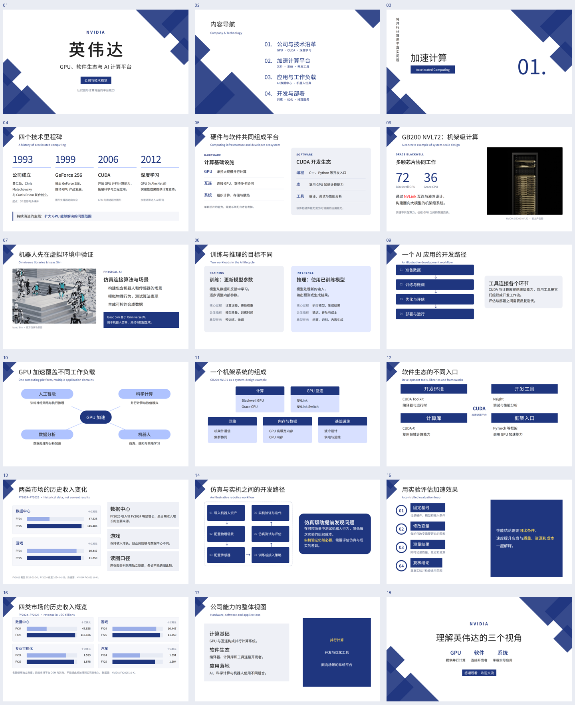

# CMR · A Slidev Theme

A light theme for Chinese technical talks: deep blue, layered **45-degree squares**, bilingual section dividers, and eighteen reusable layouts.

[中文说明](./README.zh-CN.md) · [Live NVIDIA demo](https://liuyh06.github.io/slidev-theme-cmr/) · [Example source](./example.md)



## Try from source

```sh
git clone https://github.com/liuyh06/slidev-theme-cmr.git
cd slidev-theme-cmr
npm install
npm run dev
```

Requires Node.js 22.22 or newer. The demo uses `theme: ./`, so it works independently of npm publication. `npm run starter` opens the ten-slide writing starter. NVIDIA's photos are remote assets and require a network connection.

## Use in another deck

Install the theme from npm:

```sh
npm install -D slidev-theme-cmr --registry=https://registry.npmjs.org
```

```yaml
---
theme: cmr
---
```

You can also install from source with `npm install -D github:liuyh06/slidev-theme-cmr`. The GitHub demo, npm package, and curated Slidev gallery submission are separate release steps.

## Layouts

| Layout | Use |
|---|---|
| `cover` | Main title, subtitle, authors |
| `contents` | Bilingual agenda |
| `section` | Numbered section divider and vertical quote |
| `default` | General content, timeline |
| `two-cols` | Balanced columns |
| `image-right` | Explanation with an image on the right |
| `image-left` | Explanation with an image on the left |
| `compare` | Side-by-side comparison |
| `process` | Vertical flow with a side explanation, or numbered steps |
| `radial` | Central topic with four branches |
| `modules` | Five-module overview |
| `gallery` | Four content groups around a central label |
| `chart-notes` | Two charts and explanatory notes |
| `flow-snake` | Six-step U-shaped flow with a callout |
| `icon-steps` | Icon or numbered steps with a contrasting side panel |
| `chart-grid` | Four charts and a shared caption |
| `summary` | Summary list with a contrasting side panel |
| `end` | Closing statement and thanks |

Common frontmatter: `title`, `subtitle`, optional `logo`. Section dividers additionally use `number` and `quote`. Two-column layouts accept `::right::`; chart layouts also accept `::caption::`. In `image-left`, the `right` slot is the image displayed on the left. This follows the original starter's slot convention.

```markdown
---
layout: section
title: 系统设计
subtitle: System Design
number: '02.'
quote: 用实验检验设计
---
```

Components: `CmrSteps`, `CmrRadial`, `CmrModules`, `CmrBars`, `CmrFlow`, `CmrIconSteps`. Inspect `example.md` for their data props. `CmrSteps` is static unless its `animated` prop is set. `CmrBars` accepts `title`, `unit`, `max`, and `rows`; use `max` explicitly when comparing multiple charts. `CmrRadial` supports four branches; `CmrFlow snake` is intended for six items; the module overview is designed for five groups.

Example-specific typography is isolated under `class: nvidia-demo`. Generic slides do not inherit it.

## Customize

Override CSS variables in your project's `style.css`:

```css
:root {
  --cmr-primary: #1f367f;
  --cmr-soft: #afc3ff;
  --cmr-accent: #ff3131;
  --cmr-yellow: #ffde59;
}
```

The default canvas is 960 × 540. Square positions and rotations are derived from the reference deck's transforms, including -45° and 135°. There is no university branding in the distributed theme. This is a reusable layout system, not a PowerPoint rendering engine.

The theme uses a local CJK font stack (`Noto Sans CJK SC`, `Noto Sans SC`, Microsoft YaHei, PingFang SC). Install a complete CJK font for consistent offline use. You can set `fonts.sans` in headmatter and override `--cmr-font`. No proprietary font files are included.

## Build and export

```sh
npm run check
npm run build
npx playwright install chromium
npm run export
npm run screenshots
```

`build` targets GitHub Pages at `/slidev-theme-cmr/`; for another host, use `npx slidev build example.md --base /`. The Pages workflow deploys after a push to main. Enable GitHub Pages with GitHub Actions as its source.

See [layout coverage](./docs/layout-coverage.md) for the mapping to the reference deck and [publishing](./docs/publishing.md) for release steps.

## License and credits

Theme code: [MIT](./LICENSE). The NVIDIA example is an independent educational demonstration. Third-party product images and trademarks are not licensed under MIT; see [notices](./THIRD_PARTY_NOTICES.md). All factual sources are in the example's speaker notes.
